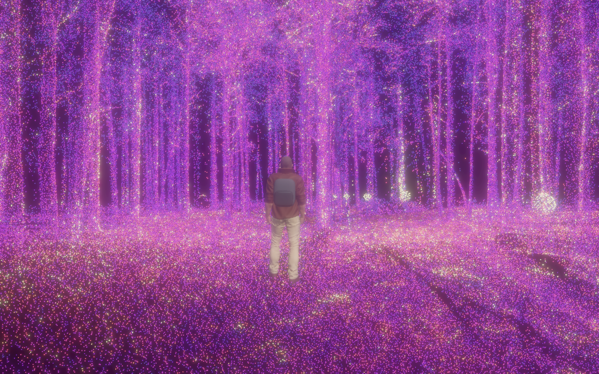
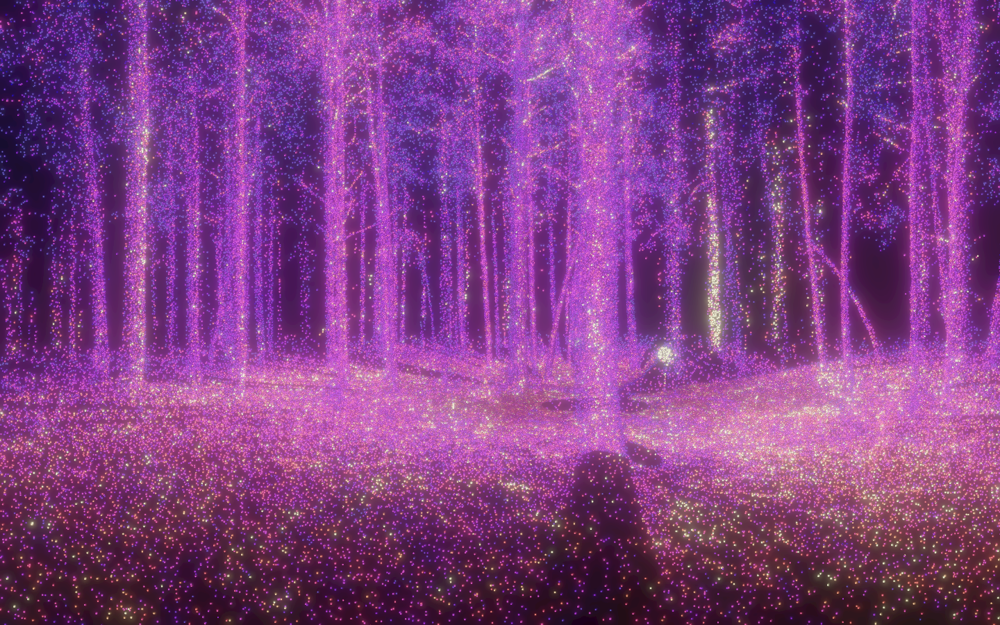
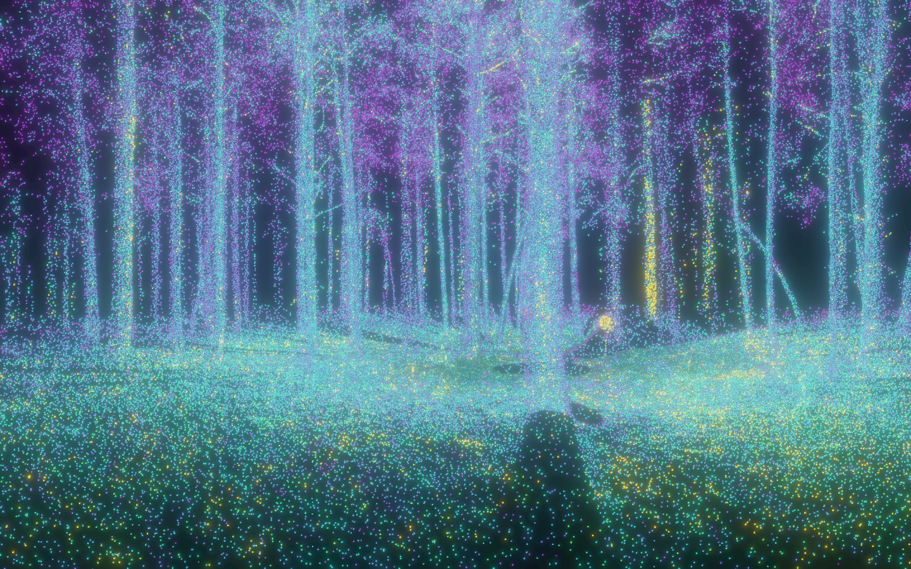
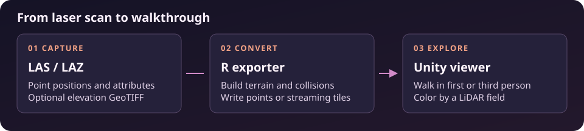

# Unity LiDAR Viewer

Walk through a laser scan in Unity. Unity LiDAR Viewer turns a LAS or LAZ point cloud into an explorable scene with terrain, tree collisions, and interactive coloring. This image shows the bundled BLK360 forest in third person, colored by LiDAR intensity with Magma and bloom.



[Windows installer · v0.1.1](https://github.com/bi0m3trics/UnityLidarViewer/releases/tag/v0.1.1) · [Install and use](Dist/INSTALL.md) · [Build from source](docs/BUILD.md) · [Revision history](news.md)

## Get started

1. Download **Unity-LiDAR-Viewer-Setup.exe** from the v0.1.1 release and run it on 64-bit Windows 10 or 11 with a DirectX 11 or 12 graphics device.
2. Launch **Unity LiDAR Viewer** from the Start menu. The bundled BLK360 forest opens in first person. Mouse look becomes available when the opening reveal finishes.
3. Move with **WASD**, run with **Shift**, and jump with **Space**. Use **V** to switch perspective, **Esc** for settings, **T** to show the terrain, and **Alt+Enter** to toggle fullscreen.

Unity and R are unnecessary for playing the bundled demo or opening an existing export. Install 64-bit R to convert new scans.

## What you can explore

- Color returns by RGB, intensity, classification, height above ground, or scalar fields available in the export. Choose Magma, Viridis, Plasma, Inferno, Cividis, Turbo, and other palettes.
- Adjust point size, contrast, emission, and bloom. Compare the same forest scan in first person below.
- Walk on a solid elevation surface and around tight tree-trunk collision proxies. Toggle the terrain and ground points independently.
- Stream large exports from spatial tiles with distance-based detail, a point budget, a memory cache, and performance counters.
- Convert LAS or LAZ with an aligned elevation GeoTIFF, or let the R exporter estimate a DEM using progressive TIN densification.

| Intensity · Magma | Intensity · Viridis |
| --- | --- |
|  |  |

## Open your own scan

The default installation is in `%LOCALAPPDATA%\Unity LiDAR Viewer`. In PowerShell, replace the example paths with your own.

```powershell
$app = Join-Path $env:LOCALAPPDATA 'Unity LiDAR Viewer'
Rscript "$app\Exporter\install_dependencies.R"
Rscript "$app\Exporter\export_to_unity.R" "D:\Scans\forest.laz" --out "D:\Exports\forest" --streaming
& "$app\UnityLidarViewer.exe" --scene "D:\Exports\forest"
```

For an existing export, run only the last command. Keep its entire folder together. Run the viewer or exporter with `--help` for available options. See the [installation guide](Dist/INSTALL.md) for DEM inputs, large exports, and controls.



## Credits

- **MK Glow Lite**, by MK Michael Kremmel, powers the viewer’s bloom. [Unity Asset Store](https://assetstore.unity.com/packages/vfx/shaders/fullscreen-camera-effects/mk-glow-lite-155643)
- **Point Cloud Viewer and Tools 3**, by m mgear, served as a reference for reviewing large point cloud rendering and streaming tradeoffs. Unity LiDAR Viewer uses its own tile streamer and point shader. [Unity Asset Store](https://assetstore.unity.com/packages/tools/utilities/point-cloud-viewer-and-tools-3-310385)
- **Adventure Character**, by Maksim Bugrimov, provides the third-person character model. Unity LiDAR Viewer retargets its animations, recolors the hiking outfit, and adds a backpack. [Unity Asset Store](https://assetstore.unity.com/packages/3d/characters/humanoids/humans/adventure-character-201384)
- **First Person + Third Person | Character Controllers**, by Unity Technologies, supplies the movement controllers and camera rig. [Unity Asset Store](https://assetstore.unity.com/packages/3d/characters/first-person-third-person-character-controllers-196526)

The [MIT license](LICENSE) covers the project’s original source and documentation. Unity and Asset Store dependencies retain their respective licenses. The release distributes the compiled application. Developers import the editable Asset Store packages separately. [Unity Asset Store terms](https://unity.com/legal/as-terms)
